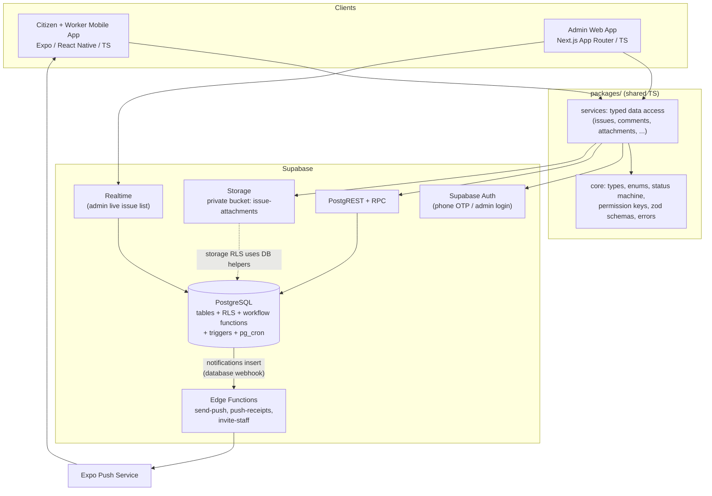

# Architecture

## 1. Recommendation in one paragraph

Keep your proposed stack. Supabase is a good fit: Postgres gives us transactions, constraints and Row Level Security (RLS), which is exactly where a permanent, tamper-resistant issue history should be enforced. The key architectural decision is: **all state-changing workflow actions go through Postgres functions (RPCs), not direct table updates.** Each RPC checks permissions, validates input, changes the issue, writes the history row, writes the audit log and queues notifications in a single transaction. Either everything is recorded or nothing changes. Reads go through normal Supabase queries protected by RLS.

## 2. System diagram



## 3. Layers and where each concern lives

| Concern | Lives in | Never in |
|---|---|---|
| UI / presentation | `apps/*/src/components`, screens/routes | – |
| Screen state, loading/empty/error | per-feature hooks in each app (`useIssue`, `useReportIssue`) | services |
| Business rules (allowed transitions, required fields per action) | **Source of truth: Postgres functions.** Mirror for UX only: `packages/core/workflow` | UI components |
| Database access | `packages/services` only | components, hooks call services, never `supabase.from()` directly |
| Authentication | Supabase Auth; session handling in `packages/services/auth` + app-specific storage adapters (SecureStore on mobile, cookies via `@supabase/ssr` on admin) | – |
| Authorization | **RLS + `has_permission()` + checks inside RPCs.** Client gets a read-only "what can I do" list (`get_my_permissions`) only to hide/show buttons | Frontend role checks that gate data |
| File handling | `packages/services/attachments` (compress, strip EXIF, upload, register); Storage RLS | – |
| Notifications | DB triggers create `notifications` rows; Edge Function delivers push | UI |
| Audit | DB triggers + RPCs write `audit_logs` | Client code |

The client-side status machine in `packages/core` exists only to decide which buttons to show. If it disagrees with the database, the database wins and the client shows a permission/conflict error.

## 4. Key technical decisions

| Decision | Choice | Reason |
|---|---|---|
| Workflow writes | Specific RPCs (`verify_issue`, `assign_issue`, `resolve_issue`, …) built on one internal `_apply_transition` helper | Atomic history + audit + notification; impossible to change status without a history row |
| Status column protection | Column-level `GRANT UPDATE` excludes `status`, timestamps, assignment fields; plus a trigger that rejects status changes outside workflow functions | Defense in depth for rule 25 |
| Timeline | `issue_timeline` view (`security_invoker = true`) over append-only tables | One source of truth, RLS still applies, no data duplication |
| Roles | DB tables `roles`, `permissions`, `role_permissions`, `user_roles` scoped per village | Configurable; nothing hardcoded in frontend |
| Roles in JWT? | **No** in V1. Permissions looked up from DB per request via a cached `STABLE` function | Role changes take effect immediately; no stale tokens. Revisit with an Auth hook if performance needs it |
| Location | `latitude`/`longitude` numeric columns + landmark text. **No PostGIS in V1** | A village has hundreds to low thousands of issues; simple distance math is enough for "similar nearby issues" |
| Photos | Private bucket, client-side compression and EXIF removal, short-lived signed URLs for viewing | Privacy (EXIF GPS, faces), bandwidth for rural networks |
| Push | Expo Push via Edge Function, triggered by DB webhook on `notifications` insert | Notifications survive app crashes; `notifications` table doubles as the outbox and in-app inbox |
| Scheduled jobs | `pg_cron` inside Postgres (auto-close, orphan upload cleanup, push receipts) | No extra infrastructure |
| Admin web data | Server Components read with the **user's** session; mutations via Server Actions that call the same RPCs | Service role key never used for normal admin work |
| Service role key | Only in two Edge Functions (`send-push`, `invite-staff`). Never in any client bundle | Least privilege |
| Time | Store `timestamptz` (UTC). Display in village timezone (default `Asia/Kolkata`) | Correct timeline ordering |
| Optimistic concurrency | `issues.version` integer; workflow RPCs take `expected_version` | Two admins acting on the same issue get a clear conflict instead of silent overwrite |

## 5. Dependencies (deliberately small)

**Both apps / shared**
- `@supabase/supabase-js` (required)
- `zod` (shared input validation; DB constraints remain the final check)
- `@tanstack/react-query` (caching, retries, refetch on reconnect, loading/error states). Justification: rules 13–17 require consistent loading, error and network-failure handling; this avoids writing our own cache layer. **Approved.**

**Mobile**
- `expo-router`, `expo-secure-store`, `expo-notifications`, `expo-device`, `expo-location`, `expo-image-picker`, `expo-image-manipulator`, `expo-localization` (all first-party Expo)
- Map picker: **none in V1** (decided). GPS capture + landmark text; staff get an "Open in Maps" link.
- i18n: `i18next` + `react-i18next` (Telugu + English decided).

**Admin**
- `next`, `@supabase/ssr`
- Styling: Tailwind CSS. Component primitives: our own small component set (decided; no shadcn/ui).
- Charts for analytics: `recharts` (one library, Phase 11 only).

**Tooling**
- pnpm workspaces (no Turborepo unless builds get slow), TypeScript strict, ESLint, Prettier, Vitest, Jest (`jest-expo`) + React Native Testing Library, Playwright (admin e2e), Supabase CLI (local DB, migrations, pgTAP tests).

Versions: pin the latest stable Expo SDK, Next.js, and Supabase CLI at the start of Phase 2 and record them in the root README.

## 6. Recommended folder structure

```
mana-village/
├── apps/
│   ├── mobile/                      # Expo app (citizens + field workers)
│   │   ├── app/                     # expo-router routes (thin; compose features)
│   │   │   ├── (auth)/              # splash, login, otp
│   │   │   ├── (tabs)/              # home, my-issues, notifications, profile
│   │   │   ├── report/              # multi-step report flow
│   │   │   ├── issue/[id]/          # details, timeline, confirm-resolution
│   │   │   ├── work/                # worker-only routes (if workers use mobile)
│   │   │   ├── announcements/
│   │   │   └── settings/
│   │   ├── src/
│   │   │   ├── features/            # issues/, report/, auth/, notifications/, work/
│   │   │   │   └── <feature>/{components,hooks}/
│   │   │   ├── components/ui/       # shared primitives: Button, Screen, EmptyState, ErrorState
│   │   │   ├── lib/                 # supabase client init, secure storage adapter, push registration
│   │   │   └── i18n/
│   │   ├── app.config.ts
│   │   └── package.json
│   └── admin/                       # Next.js App Router
│       ├── src/
│       │   ├── app/
│       │   │   ├── (auth)/login/
│       │   │   └── (console)/       # dashboard, issues, issues/[id], departments,
│       │   │                        # workers, users, categories, announcements,
│       │   │                        # analytics, audit-logs, settings
│       │   ├── features/            # same pattern as mobile
│       │   ├── components/ui/
│       │   ├── lib/supabase/        # server.ts, client.ts, middleware.ts
│       │   └── middleware.ts        # session refresh + redirect unauthenticated
│       └── package.json
├── packages/
│   ├── core/                        # pure TS, no Supabase dependency
│   │   └── src/{types,enums,workflow,permissions,validation,errors,format}/
│   └── services/                    # all Supabase access (one module per domain)
│       └── src/{auth,issues,timeline,comments,attachments,supporters,
│                assignments,notifications,announcements,admin,analytics}/
├── supabase/
│   ├── config.toml
│   ├── migrations/                  # timestamped SQL, forward-only
│   ├── seed/                        # dev/test seed only (never run in prod)
│   ├── functions/                   # Edge Functions: send-push, push-receipts, invite-staff
│   └── tests/                       # pgTAP: rls/, workflow/, storage/
├── docs/
├── .github/workflows/               # CI: typecheck, lint, unit, db tests
├── package.json / pnpm-workspace.yaml / tsconfig.base.json
└── README.md
```

Generated DB types (`supabase gen types typescript`) go into `packages/core/src/types/database.ts` and are regenerated after each migration.

## 7. Environments

| Env | Purpose |
|---|---|
| Local | Supabase CLI (Docker) + Expo dev build + `next dev` |
| Staging | Separate Supabase project, same migrations, fake seed data |
| Production | Separate Supabase project, Pro plan (backups/PITR), region **Mumbai (ap-south-1)** recommended for latency and data residency |

Migrations reach production only through CI from the main branch, never from a laptop.
