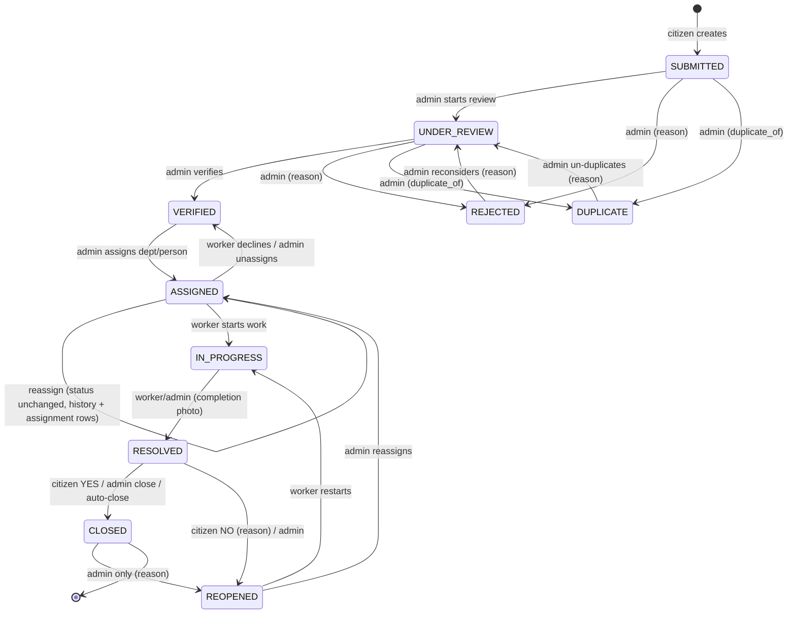

# Issue Lifecycle

## 1. State diagram

## 2. Transition table (authoritative; implemented in `_apply_transition`)

| From | To | RPC | Who (permission + context) | Required input | Side effects |
|---|---|---|---|---|---|
| – | SUBMITTED | `create_issue` | `issue.create`, own village | category, title, location (GPS or landmark), ≥1 photo (except category OTHER) | issue_number, history, notify reviewers |
| SUBMITTED | UNDER_REVIEW | `start_review` | `issue.review` | – | reviewed_at; notify reporter |
| UNDER_REVIEW | VERIFIED | `verify_issue` | `issue.verify`, not own issue | optional priority, note | verified_at; notify reporter + supporters |
| SUBMITTED, UNDER_REVIEW | REJECTED | `reject_issue` | `issue.reject` | reason (10–500 chars) | rejected_at; notify reporter |
| SUBMITTED, UNDER_REVIEW | DUPLICATE | `mark_duplicate` | `issue.mark_duplicate` | duplicate_of_issue_id, optional note | reporter **auto-added as supporter** of the original; notify reporter with link |
| VERIFIED, REOPENED | ASSIGNED | `assign_issue` | `issue.assign` | department_id, optional assignee_user_id, note, due_at | new `issue_assignments` row; notify assignee(s) + reporter |
| ASSIGNED | ASSIGNED | `assign_issue` (reassign) | `issue.assign` | same + reason | previous assignment SUPERSEDED; history row with from=to=ASSIGNED and `metadata.reassigned=true` |
| ASSIGNED | (no status change) | `accept_assignment` | `issue.work`, is assignee | – | assignment ACCEPTED; timeline event |
| ASSIGNED | VERIFIED | `decline_assignment` | `issue.work`, is assignee | reason | assignment DECLINED; notify assigners |
| ASSIGNED, REOPENED | IN_PROGRESS | `start_work` | `issue.work` assignee, or `issue.assign` | – | work_started_at; notify reporter + supporters |
| IN_PROGRESS | (no status change) | `add_progress_update` | `issue.work` assignee | note and/or progress photos | timeline event, optional notify |
| IN_PROGRESS | RESOLVED | `resolve_issue` | `issue.work` assignee, or `issue.resolve_any` | ≥1 COMPLETION photo, resolution note | resolved_at; assignment COMPLETED; **RESOLUTION_CONFIRM_REQUEST** to reporter |
| RESOLVED | CLOSED | `confirm_resolution(solved=true)` | creator | – | closed_at; history actor = citizen, `metadata.confirmation = SOLVED` |
| RESOLVED | REOPENED | `confirm_resolution(solved=false)` | creator | reason (required), optional photo | reopen_count++; notify assignee + admins |
| RESOLVED | CLOSED | `close_issue` | `issue.close` | reason | closed_at; `metadata.closed_without_citizen = true` |
| RESOLVED | CLOSED | `auto_close_resolved` (pg_cron) | SYSTEM | after `auto_close_days` (default 7) with no citizen response | history actor null, source SYSTEM, `metadata.auto_closed = true` |
| RESOLVED, CLOSED | REOPENED | `reopen_issue` | `issue.reopen` | reason | reopen_count++ |
| REJECTED, DUPLICATE | UNDER_REVIEW | `reconsider_issue` | `issue.review` | reason | approved |

Every row above, without exception, writes:
1. the `issues` update (status, timestamps, `version + 1`),
2. one `issue_status_history` row (from, to, actor, actor_role_key, reason, metadata, source),
3. one `audit_logs` row for staff actions,
4. `notifications` rows for the affected people,

in a single transaction. Any forbidden transition raises `MV_INVALID_TRANSITION`; a stale `expected_version` raises `MV_CONFLICT`.

## 3. Non-status timeline events

These appear in the timeline but do not change status: assignment accepted, progress update, photo uploaded, public comment, priority changed (staff-only view), visibility changed (staff-only), supporter count milestones (optional). They come from `issue_assignments`, `issue_attachments`, `issue_comments` and `audit_logs`, merged by the `issue_timeline` view.

## 4. Example: reconstructing your sample timeline

| Time (IST) | Source row | Shown as |
|---|---|---|
| 19 Nov 2026 10:42 | history: – → SUBMITTED, actor citizen | Citizen submitted issue |
| 19 Nov 2026 11:15 | history: UNDER_REVIEW → VERIFIED, actor EO | EO verified issue |
| 19 Nov 2026 11:30 | history: VERIFIED → ASSIGNED + assignment row (Electrical Dept) | Assigned to Electrical Department |
| 19 Nov 2026 15:20 | history: ASSIGNED → IN_PROGRESS, actor worker | Worker started work |
| 20 Nov 2026 10:10 | attachment: kind COMPLETION | Completion photo uploaded |
| 20 Nov 2026 10:15 | history: IN_PROGRESS → RESOLVED | Issue marked resolved |
| 20 Nov 2026 18:00 | history: RESOLVED → CLOSED, metadata.confirmation SOLVED, actor citizen | Citizen confirmed resolution · Issue closed |

Note: in your sample, "Citizen confirmed" and "Issue closed" are one action, so the design records **one** history row (RESOLVED → CLOSED with `confirmation = SOLVED`) and the timeline renders it as two lines. This avoids inventing an extra status.

## 5. Citizen resolution confirmation (UX contract)

1. On RESOLVED, reporter gets push + in-app notification "Your issue VLG-2026-00124 is marked solved. Please confirm."
2. Tapping opens **Resolution Confirmation** with the completion photo(s), the worker's note and two large buttons: **YES, SOLVED** / **NO, STILL NOT SOLVED**.
3. NO → reason screen (required text, optional photo; voice notes not in V1) → `confirm_resolution(false, reason)` → REOPENED.
4. If no answer: reminder notification after 3 days, then auto-close after `auto_close_days` (default 7), recorded as SYSTEM.

## 6. Duplicate handling ("I'm affected too")

1. During reporting, after category + location are chosen, the app calls `find_similar_issues(category, lat, lng)`: open issues (not CLOSED/REJECTED/DUPLICATE) in the same village and category within ~200 m (configurable), newest first, max 5, with photo thumbnail and supporter count.
2. Citizen can tap **"I'm affected too"** → `support_issue(issue_id)` → becomes a supporter, receives that issue's notifications. Report flow ends.
3. Or **"My problem is different"** → continues to create a new issue.
4. Admins can still mark an issue DUPLICATE later; the reporter is then added as supporter of the original.
5. Issue cards show "27 residents affected" (`supporter_count + 1` for the reporter).

No AI duplicate detection in V1. Category + distance + open status is simple and useful.

## 7. Priority

Set only by staff (`issue.set_priority`), default MEDIUM (or category default). Changes are audited and visible in the staff timeline. Priority never changes status or ordering rules automatically; it is used for filtering, sorting and dashboard counts ("Critical Issues").
